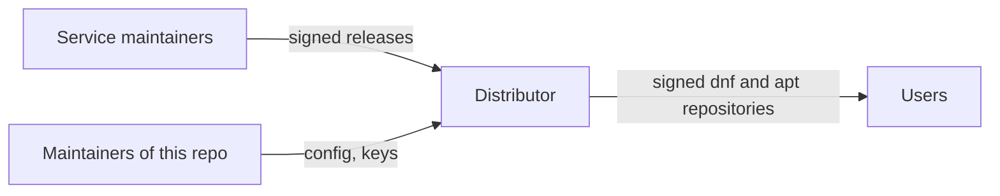

<!--
SPDX-FileCopyrightText: © 2026 OpenCHAMI a Series of LF Projects, LLC
SPDX-License-Identifier: MIT
-->

# Documentation

The distributor sits between OpenCHAMI's service repos and the people installing OpenCHAMI
packages. Each group meets it at a different point, and the docs follow that:

| Section | For | Covers |
|---|---|---|
| [Using the repositories](using/README.md) | people installing packages | adding the repositories, the keyring, what's published |
| [Publishing a service](publishing/README.md) | service repo maintainers | what a release must provide, package names, rejections |
| [Operations](operations/README.md) | maintainers of this repo | deployment, the config, issues, the archive key |
| [Design](design/README.md) | anyone who wants the why | the pipeline, trust model, state, and their decisions |
| [Development](development/README.md) | contributors | code layout, conventions, the integration tests |

The sections build on each other in one direction: Using and Publishing describe what you do,
Operations what keeps it running, and Design why it works the way it does. Each links to Design
for the reasoning rather than repeating it.

[Back to the project README](../README.md)
