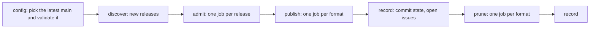

<!--
SPDX-FileCopyrightText: © 2026 OpenCHAMI a Series of LF Projects, LLC
SPDX-License-Identifier: MIT
-->

# Design

How the distributor turns signed service releases into signed dnf and apt repositories, and why
it's built the way it is. For running it, see [Operations](../operations/README.md); for what a
service repo has to provide, see [Publishing](../publishing/README.md).

## The pipeline

Every poll runs the same stages in order. Each stage is a reusable workflow; `poll.yml` only
wires them together.

| Stage | Reads | Writes | Owns |
|---|---|---|---|
| [Discover](discovery.md) | the config, state, the GitHub releases API | a job matrix | which releases to look at |
| [Admit](admission.md) | one release's assets | a result file (artifact) | whether a release may be published |
| [Publish](publishing.md) | the admitted packages | the target, a delta (artifact) | adding packages and metadata |
| [Record](state.md) | results and deltas | `state/state.json`, issues | the only writer of state |
| [Prune](pruning.md) | state, the config | the target, a delta (artifact) | removing packages and metadata |

Four rules hold the stages together. Each page above relies on them:

- **Parallel where it's safe.** Releases and formats fan out; only a format's repository metadata
  and the state file are written serially.
- **Scatter and gather through artifacts.** Parallel jobs never write shared state. They upload
  results, and record applies them in one place.
- **One concern per stage.** Admit decides, publish only adds, prune only removes, record only
  writes state and issues. A rejection never touches the target, and publishing never deletes.
- **Fail closed, heal on the next run.** A rejection is a normal outcome and is recorded. An
  infrastructure failure records nothing, so the next poll retries the same work; every stage is
  idempotent so that retry is safe.

## Where things live

- [State](state.md): `state/state.json`, the record of every decision and what is published.
  It's also the public audit trail of what the archive key has signed.
- [Target layout](target-layout.md): the bucket, laid out as one rpm repository and one apt
  suite.
- [Trust model](trust-model.md): the key hierarchy behind a release, and how the archive key
  re-signs what's admitted.
- [Concurrency](concurrency.md): why every writer shares one lock, and how a queued run still
  sees the latest state.

[Back to the documentation index](../README.md)
