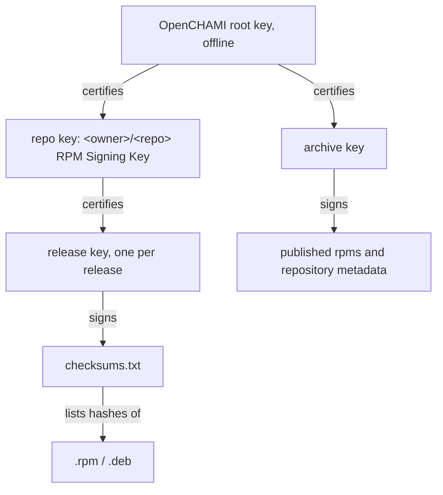

<!--
SPDX-FileCopyrightText: © 2026 OpenCHAMI a Series of LF Projects, LLC
SPDX-License-Identifier: MIT
-->

# Trust model

Two signatures protect a package: the service's, checked once by the distributor, and the
archive key's, checked by every client.

- **The root key is pinned.** Admission takes it from the `MASTER_PUBLIC_ASC` and `MASTER_FPR`
  org secrets, never from a release, so a release can't bring its own root.
- **The repo key is bound to its repo.** Its certified name must be `<owner>/<repo> RPM Signing
  Key` for the repo being admitted, so one repo's key can't vouch for another repo's release.
- **The chain is checked by github-actions' own script,**
  [`gpg-verify-trust-chain.sh`](https://github.com/OpenCHAMI/github-actions/blob/main/scripts/gpg-verify-trust-chain.sh),
  pinned by commit (Renovate updates it), so releases are verified the way they were signed.
- **Clients trust one key.** The archive key re-signs whatever is admitted. Users never see repo
  or release keys, and a repo key can be revoked ([config](../operations/config.md)) without
  touching clients.
- **Publishers are the real gate.** A service's release workflow signs whatever a `v*` tag points
  at, for whoever pushed it. So admission checks that everyone involved in the tag's push runs is
  a listed publisher for that repo ([admission](admission.md)); that list lives here, in the
  config, not in each service repo.

Key handling: [archive key](../operations/archive-key/README.md); repo and release keys:
github-actions' [signing docs](https://github.com/OpenCHAMI/github-actions/blob/main/docs/signing.md).

[Back to Design](README.md)
