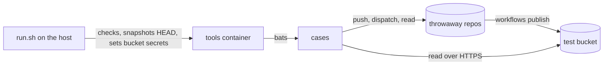

<!--
SPDX-FileCopyrightText: © 2026 OpenCHAMI a Series of LF Projects, LLC
SPDX-License-Identifier: MIT
-->

# Integration tests

`tests/integration/` runs the distributor end to end on real GitHub and a real S3 bucket, with
[bats-core](https://github.com/bats-core/bats-core). Each test makes releases on throwaway
service repos, dispatches polls of a throwaway distributor, and checks its state, issues, and
bucket.

Two suites, split by what their container may do:

| Suite | Tests | Container gets |
|---|---|---|
| [pipeline](pipeline.md) | the distributor's behavior: admission, publishing, pruning, keys | GitHub (your token, your SSH agent), the bucket's public URL |
| [clients](clients.md) | dnf and apt installing from the bucket | the same, plus your rootless podman's socket |

The clients suite is separate because the podman socket lets code in its container start
containers as you. Review `tests/integration/clients/` before running it. The pipeline suite never
gets the socket.

Both share one set of throwaway repos, one test bucket, and the same per-run setup, so they run
one at a time.

- [Setup](setup.md): the one-time repos and bucket, and your config.
- [Writing tests](writing-tests.md): the harness, the lifecycle, and how a case is shaped.

[Back to Development](../README.md)
