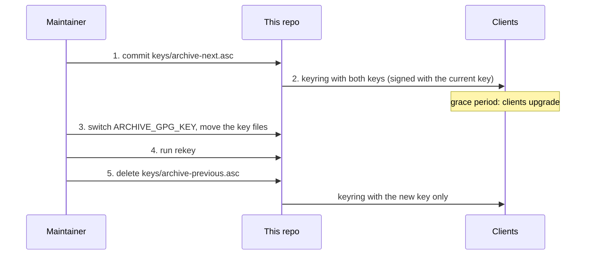

<!--
SPDX-FileCopyrightText: © 2026 OpenCHAMI a Series of LF Projects, LLC
SPDX-License-Identifier: MIT
-->

# Rotation

Yearly, by hand. Start at least `2 × archive_key.warn_days` (60 days by default) before the
current key expires: one period of grace for clients to pick up the next key, before polls start
failing for the expiring one.

1. **Generate the next key** offline, have the root key certify it, and commit its public key as
   `keys/archive-next.asc`.
2. **Wait.** The `keyring` workflow releases a keyring carrying both keys, signed with the current
   one, so clients get the next key through a normal upgrade. After `warn_days`, an
   `Archive key switch due` issue says the grace period is over.
3. **Switch.** Set `ARCHIVE_GPG_KEY` (and the passphrase) to the next key; workflows can't edit
   secrets. In one commit, move `archive.asc` to `archive-previous.asc` and `archive-next.asc` to
   `archive.asc`. New packages are signed with the new key from then on.
4. **Run `rekey`.** It re-signs every published rpm not yet signed with the current key, batch by
   batch, then the rpm and apt metadata, and republishes `keys/`. Each batch is recorded, so a
   failed or timed-out run just needs running again.
5. **Delete `keys/archive-previous.asc`** once `rekey` has finished. The keyring is rebuilt
   without the old key.

debs carry no signature, so for apt only `Release` is re-signed.

[Back to Archive key](README.md)
