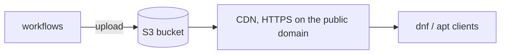

<!--
SPDX-FileCopyrightText: © 2026 OpenCHAMI a Series of LF Projects, LLC
SPDX-License-Identifier: MIT
-->

# Deployment

The distributor only uploads to an S3 bucket; serving it is set up outside this repo.

## Bucket

- One [S3](https://aws.amazon.com/s3/) (or S3-compatible) bucket, holding the
  [target layout](../design/target-layout.md).
- Objects publicly readable; listing not public.
- Uploads set `Cache-Control` per object, since S3 has no bucket-wide default: packages
  `public,max-age=31536000,immutable` (a version never changes), metadata and keys
  `public,max-age=<metadata_max_age>,must-revalidate`.

## CDN and domains

- A CDN in front of the bucket (e.g. CloudFront) gives HTTPS on a custom domain, which S3
  website endpoints don't.
- It must honor the bucket's `Cache-Control`: metadata (`rpm/repodata/`, `deb/dists/`, `keys/`)
  for at most `metadata_max_age`, packages (`rpm/packages/`, `deb/pool/`) indefinitely. No
  invalidation is needed; metadata expires on its own.
- Repository metadata uses relative paths, so the domain appears only in client setup
  ([using](../using/README.md)).

## Settings and secrets

| Name | Kind | Used by | What |
|---|---|---|---|
| `target.s3` | config | publish, prune, rekey | `bucket`, `region`, `metadata_max_age`; `endpoint` for services other than AWS |
| `AWS_ACCESS_KEY_ID`, `AWS_SECRET_ACCESS_KEY` | secret | publish, prune, rekey | `s3:GetObject`, `s3:PutObject`, `s3:DeleteObject`, and `s3:ListBucket` on the bucket |
| `ARCHIVE_GPG_KEY`, `ARCHIVE_GPG_PASSPHRASE` | secret | keys check, publish, prune, rekey, keyring | the [archive key](archive-key/README.md), armored or base64; the passphrase if it has one |
| `MASTER_PUBLIC_ASC`, `MASTER_FPR` | org secret | admit | the root public key and its fingerprint ([trust model](../design/trust-model.md)) |

`s3:ListBucket` matters: without it, S3 reports a missing file as access denied rather than
missing, and publish fails instead of starting a repository's metadata fresh.

Each script checks the variables it needs before doing anything, and names every one that's
missing.

[Back to Operations](README.md)
