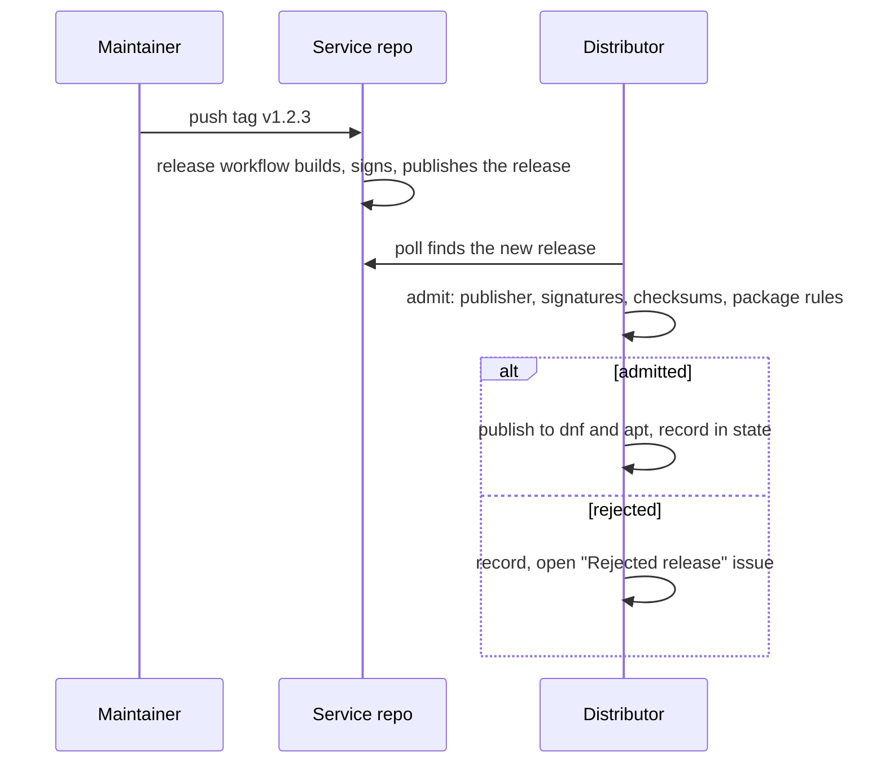

<!--
SPDX-FileCopyrightText: © 2026 OpenCHAMI a Series of LF Projects, LLC
SPDX-License-Identifier: MIT
-->

# Publishing a service

For maintainers of an OpenCHAMI service repo who want its packages in the OpenCHAMI repositories.
Once a repo is set up, there's nothing to do per release: tag it, and the next poll (within
minutes) publishes it or opens an issue explaining why not.

Getting a repo distributed:

1. **Release workflow**: build and sign releases the way github-actions does
   ([release](release.md)).
2. **Repo key**: a repo key certified by the OpenCHAMI root key as
   `<owner>/<repo> RPM Signing Key` (see the [trust model](../design/trust-model.md)).
3. **Config entry**: a maintainer of this repo adds your repo under `repos` in
   `config/distributor.yaml`, and adds your publishers under `publishers`
   ([config](../operations/config.md)). Your release workflow signs whatever a `v*` tag points
   at, for whoever pushed it; the publishers list is what decides whose tags get published.
4. **Package names**: name your packages after the repo, or have them added to its `allow`
   ([package names](package-names.md)).

When a release is rejected, the issue lists every reason, and the fix is always a new patch
release ([rejections](rejections.md)). The checks themselves are described in
[admission](../design/admission.md).

[Back to the documentation index](../README.md)
